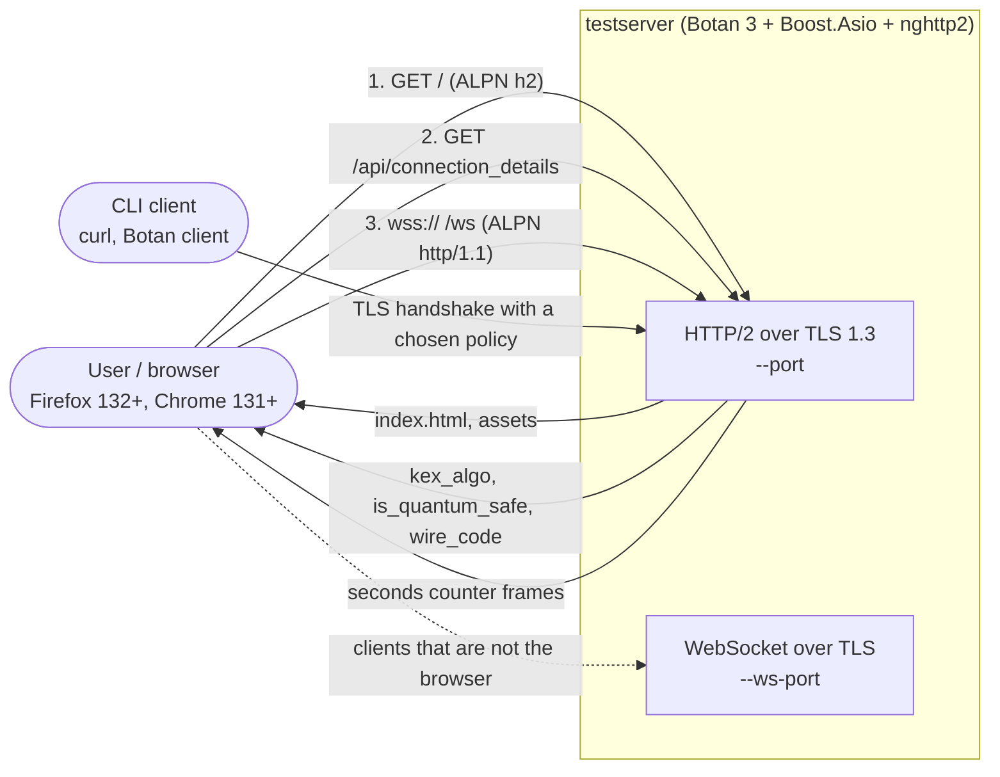
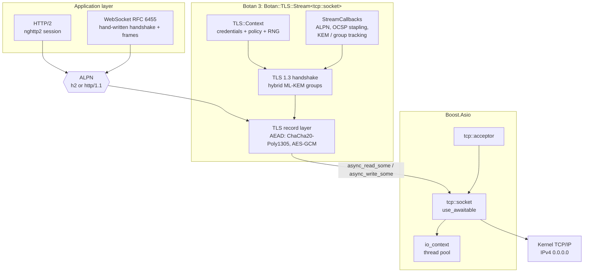
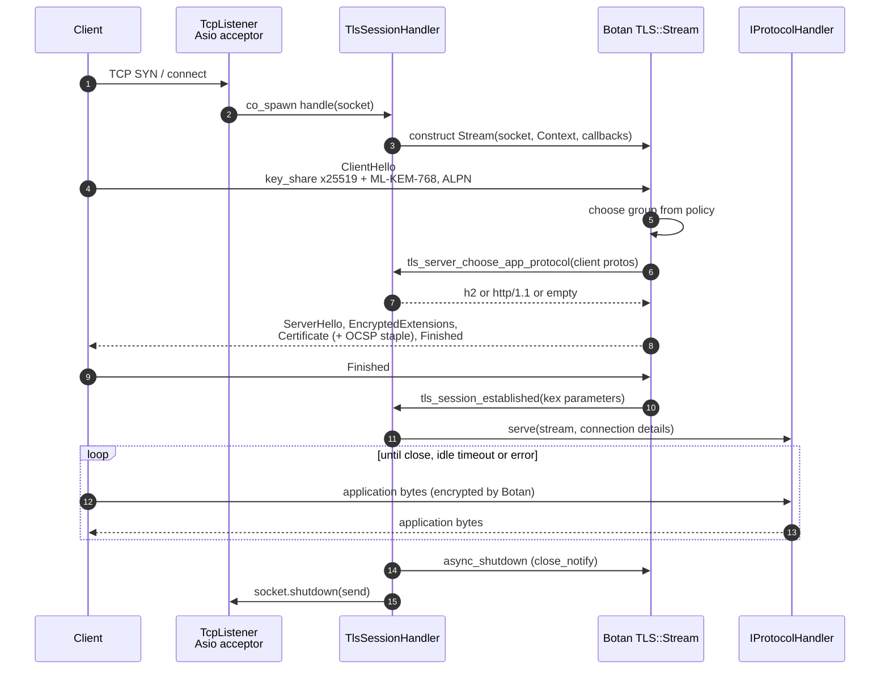
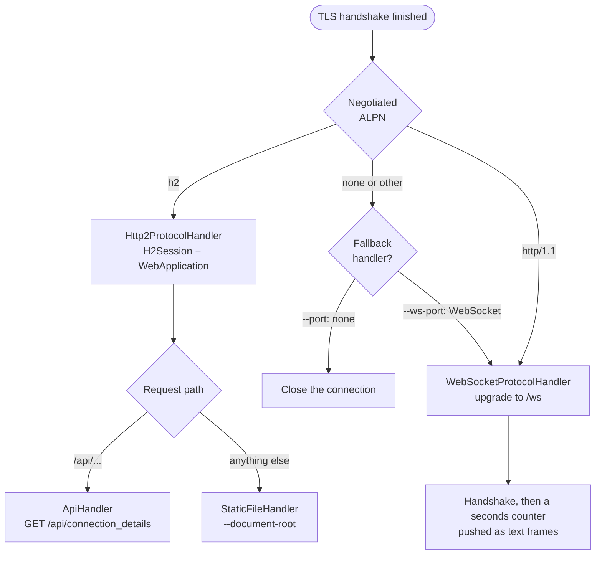
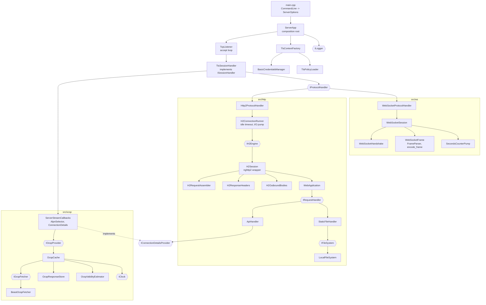
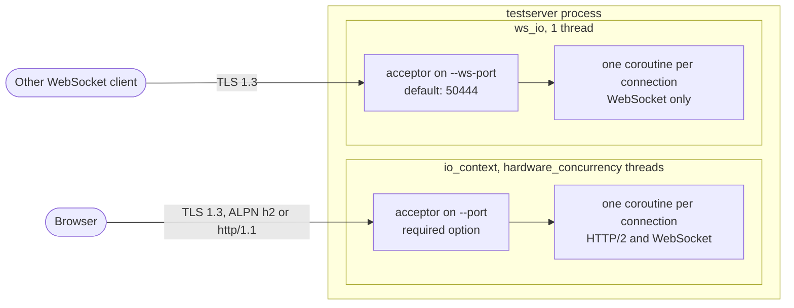
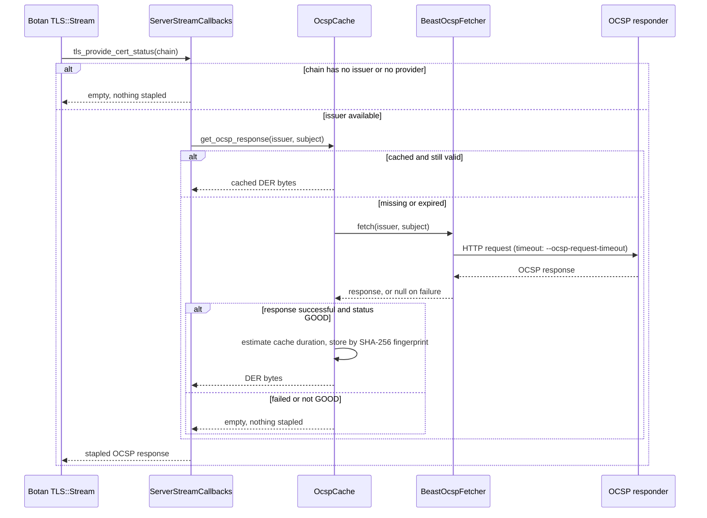

# Botan Hybrid TLS Test Server

This simple web app can be used to test your client against Botan's TLS
implementation. The server uses Boost.Asio for TCP, [Botan's asio
stream](https://botan.randombit.net/handbook/api_ref/tls.html#tls-stream) for
TLS 1.3 (including the post-quantum groups in the policy files) and nghttp2 for
HTTP/2. The same TLS port also accepts a WebSocket when the client negotiates
ALPN `http/1.1`: the handshake and the frames go through the same
`Botan::TLS::Stream`, and the server pushes a seconds counter to the page. A
second thread keeps `--ws-port` for clients that are not the browser.

The app displays a web page inspired by [Cloudflare's post-quantum TLS test
page](https://pq.cloudflareresearch.com), that visualizes what key exchange
algorithm was used to establish the TLS connection from the user's browser and
the test server.

## Online Test

A running version of the app is deployed here:
[https://pq.botan-crypto.org](https://pq.botan-crypto.org).

## Use case

The server exists to answer one question from a client's point of view: *which
key exchange did my TLS 1.3 connection actually use, and is it post-quantum
safe?* A browser (or any TLS client) loads the page over HTTP/2, the page asks
`/api/connection_details` what the server negotiated, and a WebSocket over the
same TLS session keeps a live seconds counter running.



The result the page shows depends on the TLS policy loaded with `--policy`:

| Policy file | Key exchange groups offered | Intended client |
|---|---|---|
| `policies/tls_hybrid_pqc_browser.txt` | `x25519/ML-KEM-768`, then `x25519`, `secp256r1`, `secp384r1` | Current browsers |
| `policies/tls_browser_compat.txt` | `x25519`, `secp256r1`, `secp384r1` | Browsers without ML-KEM |
| `policies/pqc_basic.txt` | `ML-KEM-768`, `ML-KEM-1024`, `x25519/ML-KEM-768` | Botan clients |
| `policies/pqc_all.txt` | Every group Botan knows, including Kyber and FrodoKEM variants | Experiments |

## Architecture

### Network stack

One accepted TCP connection becomes one coroutine. Boost.Asio owns the socket
and the event loop, `Botan::TLS::Stream` wraps the socket and performs TLS 1.3,
and the application protocol on top (HTTP/2 or WebSocket) is chosen by the ALPN
value negotiated in the handshake.



### Connection lifecycle

Both listeners run the same sequence: accept, TLS 1.3 handshake, protocol
dispatch by ALPN, orderly TLS shutdown.



### ALPN dispatch

`TlsSessionHandler` looks up the negotiated ALPN protocol in a map of
`IProtocolHandler`s. The HTTP/2 port and the WebSocket port differ only in that
map and in the fallback handler.



### Components

The code is split into small classes behind interfaces, wired together in
`ServerApp` by constructor injection. Everything except `main.cpp` is in the
static library `testserver_core`, which is what the unit tests link.



The hexagons in the diagram are interfaces. The unit tests replace them with
GoogleMock mocks.

### Threads and ports



### OCSP stapling

When the certificate chain has an issuer, the server staples an OCSP response
during the handshake. Responses are fetched with Beast and cached for
`--ocsp-cache-time` minutes (or less, if the response expires sooner). The
server does not verify the responder's signature; the client does.



## Build

Install the latest Botan 3, Boost and nghttp2 into `/usr/local` (the script uses `sudo` when it is not already root):

```bash
./3rdparty/install.sh
cmake -B build -S .
make -C build
```

The install script also installs GoogleTest and GoogleMock (`libgtest-dev`,
`libgmock-dev`) with apt, which the unit tests need. Pass `-DBUILD_TESTING=OFF`
to `cmake` to build without them.

## Tests

The server code lives in a static library (`testserver_core`) behind small
interfaces (`IClock`, `ILogger`, `IFileSystem`, `IH2Responder`, `IH2Engine`,
`IOcspFetcher`, ...), so the unit tests in `tests/` replace the network, disk,
clock and OCSP responder with GoogleMock mocks:

```bash
cmake -B build -S .
cmake --build build
ctest --test-dir build --output-on-failure
```

## Run

You'll need a certificate for your test server. If you don't have one, you can
create a basic certificate with Botan's CLI tool (`/usr/local/bin/botan`). From the repository's root run:

```bash
mkdir certs

botan keygen --algo=ECDSA --params=secp384r1 --output=certs/ca.key
botan keygen --algo=ECDSA --params=secp384r1 --output=certs/server.key
botan gen_self_signed --ca --country=DE --dns=localhost --hash=SHA-384 --output=certs/ca.pem certs/ca.key localhost
botan gen_pkcs10 --output=certs/server.req certs/server.key localhost
botan sign_cert --output=certs/server.pem certs/ca.pem certs/ca.key certs/server.req
```

Now, it's time to start the server application:

```bash
build/testserver --cert certs/server.pem --key certs/server.key --port 50443 --policy policies/tls_hybrid_pqc_browser.txt
```

`policies/tls_hybrid_pqc_browser.txt` offers `x25519/ML-KEM-768` first. Firefox 132+ and Chrome 131+ negotiate that hybrid; older browsers fall back to `x25519`. `policies/pqc_basic.txt` is ML-KEM only and is for Botan clients, not browsers. `policies/tls_browser_compat.txt` is classical groups only.

HTTP/2 listens on `--port` and requires ALPN `h2`. The same port also accepts a WebSocket when the client offers ALPN `http/1.1`, so the page and `wss://` share the certificate. `--ws-port` (default `50444`) is an extra WebSocket listener for clients that are not the browser.

Open [https://localhost:50443](https://localhost:50443) and accept the self-signed certificate. The page shows the negotiated group. On a current browser that is `x25519/ML-KEM-768` with `is_quantum_safe` true, and the seconds counter advances over `wss://localhost:50443/ws`.

From the command line:

```bash
curl --http2 -k https://127.0.0.1:50443/
curl --http2 -k https://127.0.0.1:50443/api/connection_details
```

`GET /api/connection_details` returns JSON like:

```json
{"kex_algo": "x25519/ML-KEM-768","is_quantum_safe": true,"wire_code": "0x11ec","websocket_port": 50443}
```

The wire code is whatever Botan assigns to that group. A client without ALPN `h2` receives no HTTP/1 page; the HTTP/1 listener on this port only completes a WebSocket upgrade to `/ws`.