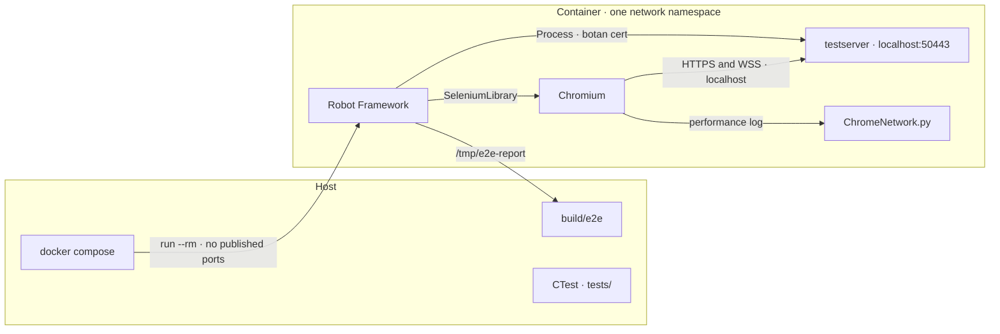

# End-to-end tests

These tests open the real page in Chromium and check that the browser used HTTP/2 over TLS 1.3. They are separate from the unit tests in `tests/`, which run on the host with CTest and do not start a browser.

`curl --http2` can speak HTTP/2, but it is not the browser. The page itself cannot tell either: `performance.getEntries()` and `fetch` do not expose ALPN or the TLS version. Chromium reports both in the DevTools event `Network.responseReceived`: `response.protocol` is `h2` and `response.securityDetails.protocol` is `TLS 1.3`. SeleniumLibrary opens the browser. `ChromeNetwork.py` then reads that event from the performance log of the same session. A response without `securityDetails` fails the test, because TLS was not observed.

The WebSocket on `/ws` is ALPN `http/1.1` on purpose (RFC 6455, no extended CONNECT). The suite checks that the seconds counter reaches `1`. It does not require that socket to be HTTP/2.

## What the container is

`docker/Dockerfile` and `docker/compose.yml` define one service. The image is Debian bookworm. Ubuntu's `chromium` package is a snap stub and does not start in a container; Debian ships `chromium` and a matching `chromium-driver`.

The image builds Botan, Boost and nghttp2 with `3rdparty/install.sh`, then builds `testserver` with `-DBUILD_TESTING=OFF`. It does not compile or run `testserver_tests`. Chromium, chromedriver and the Python packages in `e2e/requirements.txt` are installed in the same image.

Chromium and the server share the container's network namespace and talk over `localhost:50443`. The suite generates a throwaway certificate for that name with `botan` and starts `testserver` through Robot's Process library, so nothing is published on the host and the certificate does not need another SAN. A second service would have to route the certificate name and the host Chromium connects to.



The unit tests stay on the host. Inside the container the only network path is `localhost`. The report volume is the only data that leaves it.

SeleniumLibrary's `Open Browser` starts Chromium with:

| Flag | Why |
|---|---|
| `--headless=new` | No display in the container. |
| `--ignore-certificate-errors` | The certificate is generated for this run and is not in the trust store. |
| `--allow-insecure-localhost` | The page is served on localhost with that certificate. |
| `--no-sandbox` | A container does not have the privileges Chromium's sandbox needs. |
| `--disable-dev-shm-usage` | The container's `/dev/shm` is too small for Chromium. |

`goog:loggingPrefs` asks Chromium for the performance log that carries the network events.

## Run

From the repository root:

```bash
docker compose -f docker/compose.yml build
docker compose -f docker/compose.yml run --rm e2e
```

The default command excludes the `pqc` tag. Reports are written to `build/e2e/` through the compose volume.

The hybrid group needs Chromium 131 or newer (it advertises `X25519MLKEM768`). The Chromium package in Debian bookworm can be older and then falls back to `x25519`. Run that case on its own:

```bash
docker compose -f docker/compose.yml run --rm e2e \
  robot -i pqc --outputdir /tmp/e2e-report e2e/tests
```

If it fails, `log.html` shows the group the page actually displayed.
